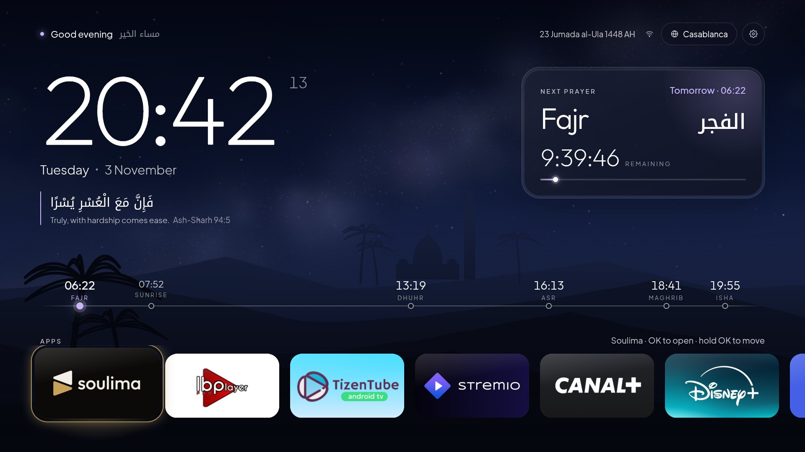
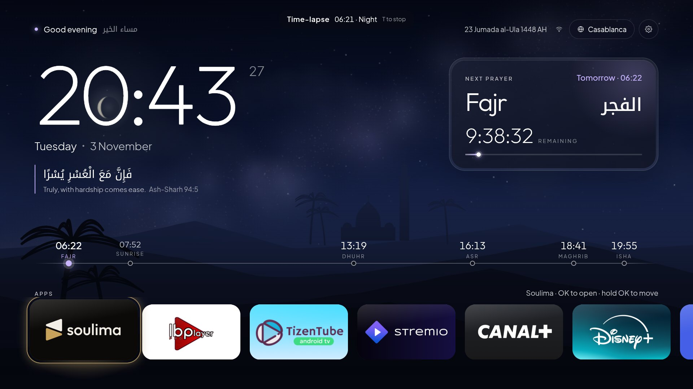
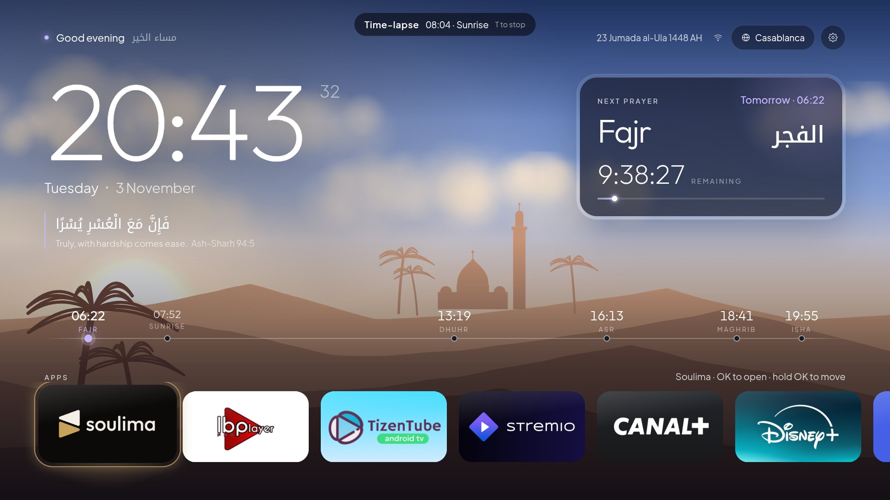
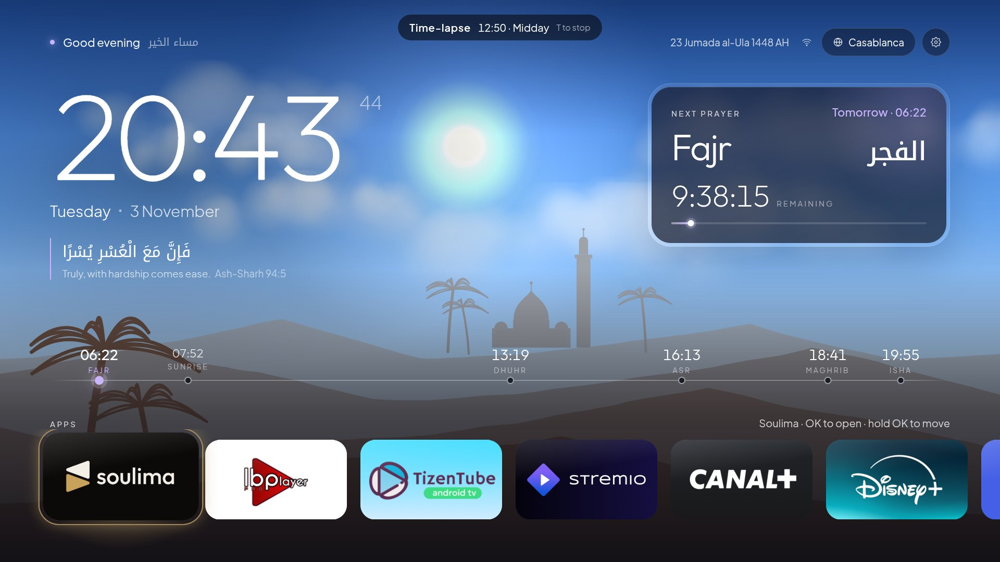
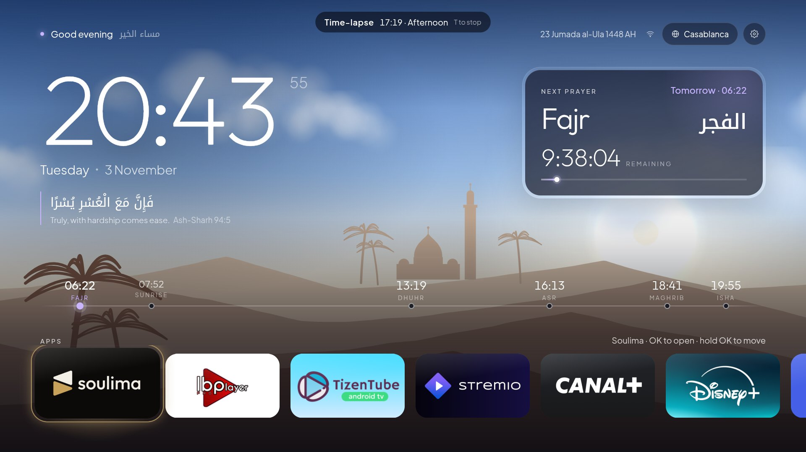
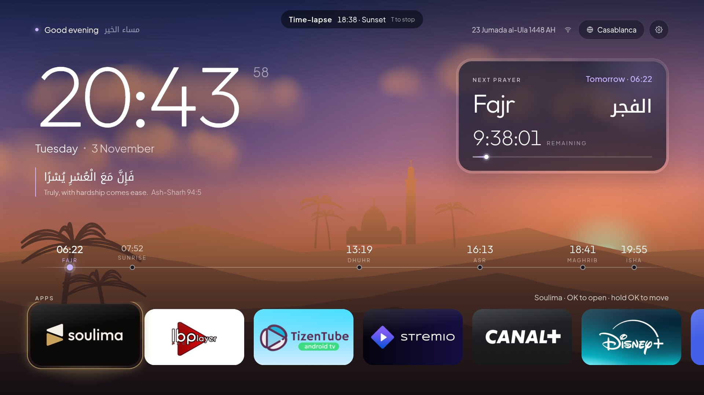
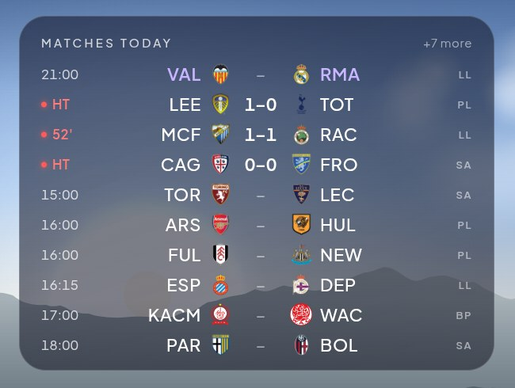
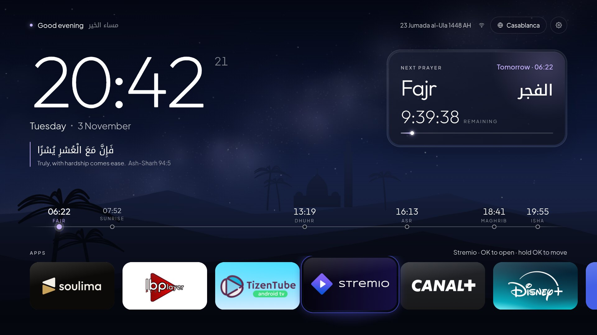
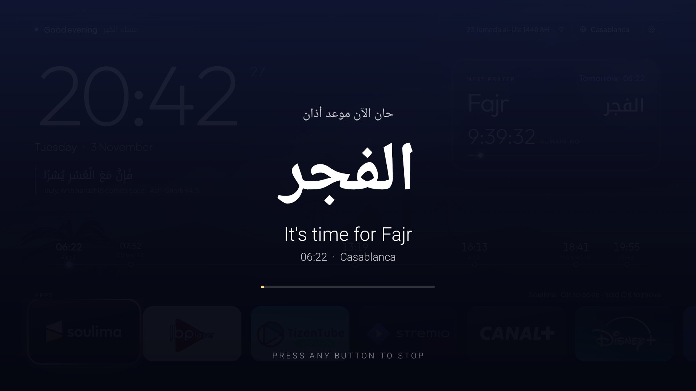
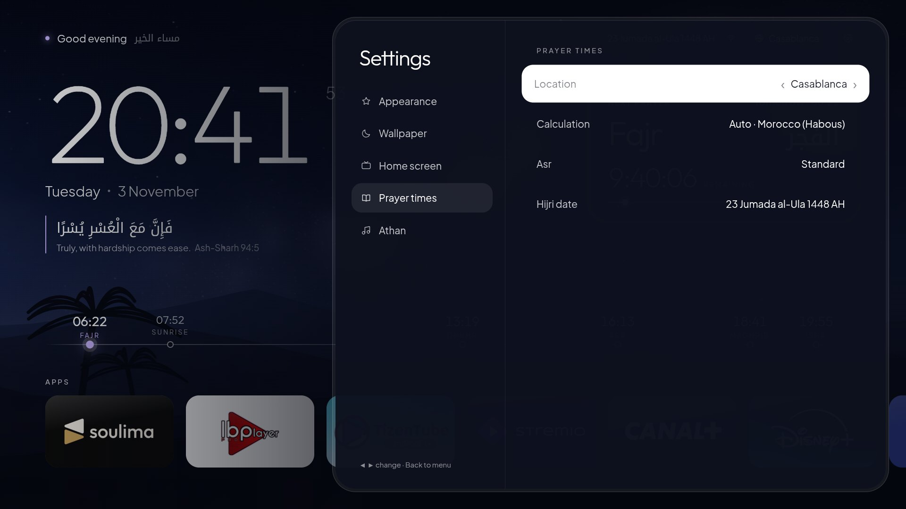

# Horizon — Android TV home screen with prayer times & athan

A calm, lightweight home screen (launcher) for **Android TV / Google TV**. It replaces your TV's
home with a live wallpaper that follows the real sun and moon, your apps in a clean row, the
five daily prayer times, and a **full athan that plays at every prayer**, even while you're
watching something else.



**[⬇ Download the latest APK](https://github.com/youssefenafour123-art/horizon-tv-launcher/releases/latest)** · 2.2 MB · Android 7.0+ · no ads, no tracking, no account

---

## What you get

| | |
|---|---|
| **Moroccan photos & AI paintings** | Besides the painted live scenes (Sahara, Atlas lake, Essaouira, medina, Aït Benhaddou, Koutoubia, Merzouga caravan…), 33 high-resolution photos of Morocco taken in the morning, at midday, in the evening and at night (Chefchaouen, Hassan II, the Koutoubia, Jemaa el-Fnaa, Fes, Essaouira, Aït Benhaddou, Erg Chebbi, the Atlas…). The wallpaper follows the time of day with a photo taken at that time, and changes to another one every hour (Settings → Wallpaper → Photo changes). Add your own AI paintings with the prompts in [wallpapers/ai/PROMPTS.md](wallpapers/ai/PROMPTS.md). Settings → Wallpaper → Category: Painted · Real photos · AI paintings. |
| **Live wallpaper that follows the sky** | Painted scenes (Sahara, Atlas lake, Essaouira coast, rolling hills, medina) whose sky is calculated from the real position of the sun and moon where you live: before dawn, sunrise, midday, afternoon, golden hour, sunset, dusk and night, with stars, the Milky Way, the moon in its real phase, clouds and birds. |
| **Prayer times, offline** | Calculated on the TV itself (no internet needed after your city is known). Methods: Morocco (Habous), Muslim World League, Umm al-Qura, Egyptian, Gulf, Karachi, ISNA, Algeria, Tunisia, Turkey (Diyanet), France (UOIF). Standard or Hanafi Asr. Picked automatically from your country. |
| **Your mosque's timetable** | Optional: use the exact times of your mosque from [Mawaqit](https://mawaqit.net) instead of calculating them. Set it once with `adb shell am start -n com.horizon.launcher/.MainActivity --es mosque <slug>` (the slug is the end of the mosque's Mawaqit address, e.g. `bischheim` for mawaqit.net/fr/m/bischheim). The yearly timetable is saved on the TV and refreshed daily; switch between the mosque and calculated times in Settings → Prayer times → Timetable. |
| **Full athan at each prayer** | Uses Android's alarm system, so it plays even inside Netflix or YouTube, survives reboots, pauses what's playing, and shows a full-screen athan card. Any remote button stops it. Each prayer can be switched on or off separately, and the volume is adjustable. |
| **Your real apps** | Every installed app with its own TV banner. The selected app gets a glowing edge in its own color. **Hold OK on an app to move it**: ◀ ▶ to move, ▲ to put it first. |
| **Make it yours** | 7 font styles, clock size and weight, an accent color that can follow the sky, 12/24-hour clock, five scenes, live or still wallpaper, dim level, and a Quran verse that changes through the day. |
| **Matches of the day** | Today's football on the home screen: LaLiga, Premier League, Serie A, Ligue 1, Botola Pro, Champions League, Europa League, Conference League, and national teams (World Cup, EURO, Nations League, AFCON, Copa América, their qualifiers and friendlies). Short club codes with crests, live minute and score. Real Madrid and Morocco come first on days they play. Select the card for the full list, day by day. |
| **Formula 1 on race weekends** | An F1 tab appears on the matches card from the day before practice until the race is over: every session (practice, sprint, qualifying, race) in your local time, the live lap, and each session's top three. ◀ ▶ switches tabs. |
| **Hijri date** | Umm al-Qura calendar, with a ±2-day adjustment for local moon sighting. |
| **Ambient mode** | After a quiet minute the interface fades and only the sky and the clock remain. |

## Screenshots

All screenshots come from a real TCL Google TV (1080p). The apps shown are simply the ones installed on that TV; Horizon shows whatever *you* have installed.

**The same screen through the day** (the wallpaper follows the real sun):

| Before dawn | Sunrise |
|---|---|
|  |  |
| **Midday** | **Afternoon** |
|  |  |
| **Sunset** | **Night** |
|  |  |

**Matches of the day**, with live scores (select the card for every game, day by day):



**Your apps**, with their own banners. The selected app glows in its own color, and you can hold OK to reorder:



**Athan screen**, shown at prayer time over whatever is playing:



**Settings**, with every change previewed live behind the panel:



> The "Time-lapse" pill at the top of some screenshots is the built-in preview that plays a whole day in one minute. It isn't shown normally.

---

## Install

You need a computer on the same Wi-Fi as the TV, plus Google's free **adb** tool ([platform-tools](https://developer.android.com/tools/releases/platform-tools)).

1. **On the TV**: Settings → System → About → click **Android TV OS build** 7 times. Then in Settings → System → **Developer options**, turn on **USB debugging** (and **Wireless/Network debugging** if listed). Note the TV's IP address (Settings → Network).
2. **On the computer**:
   ```bash
   adb connect 192.168.1.40:5555        # your TV's IP; accept the prompt on the TV
   adb install Horizon-1.5.apk
   ```
3. Open **Horizon** from the TV's app list. On first launch, allow location if asked (used only to pick your city; you can also choose a city by hand).

You can also sideload it with a USB stick or the *Downloader* app.

### Make Horizon your home screen

Press **Home** on the remote. If the TV asks which home app to use, choose **Horizon → Always**. Done.

**Google TV doesn't ask**: it keeps its own home on the Home button. To switch it off *for your user only* (nothing is deleted, and it's fully reversible):

```bash
adb shell cmd package set-home-activity --user 0 com.horizon.launcher/.MainActivity
adb shell pm disable-user --user 0 com.google.android.apps.tv.launcherx
adb shell pm disable-user --user 0 com.google.android.tungsten.setupwraith
```

`setupwraith` is Google's setup/recovery screen; if it stays on, it takes over the Home button.

**To go back** to the original Google TV home at any time:

```bash
adb shell pm enable com.google.android.apps.tv.launcherx
adb shell pm enable com.google.android.tungsten.setupwraith
```

A factory reset also restores everything.

### Optional: show the athan over other apps

Sound always plays. To also see the athan card while another app is open, go to Horizon → Settings → Home screen → **Athan over other apps** and allow it (or run `adb shell appops set com.horizon.launcher SYSTEM_ALERT_WINDOW allow`).

---

## Using it

| Remote | What it does |
|---|---|
| ◀ ▶ ▲ ▼ | Move around |
| OK | Open the app |
| Hold OK on an app | Move mode: ◀ ▶ moves it, ▲ puts it first, OK or Back drops it |
| Back | Close a panel (Back never leaves the home screen) |
| Home | Return to Horizon and jump to the first app |
| ⚙ (top right) or the **Settings** card | Settings |

**Settings sections**

- **Appearance**: font style (Modern, Elegant, Editorial, Rounded, Minimal, Tech, Bold), clock size and weight, accent color, 12/24-hour, seconds
- **Wallpaper**: scene, mode (Live · Still · My photos), dim, parallax, "Preview a full day"
- **Home screen**: greeting, verse, how often the verse changes, prayer timeline, ambient mode delay, reset app order, athan over other apps, Android TV settings
- **Matches**: show the card, each league, national teams, Formula 1, and Real Madrid / Morocco on or off
- **Prayer times**: location (automatic or a list of cities), calculation method, Asr, Hijri date ±days
- **Athan**: on/off, volume, on/off per prayer, test

**Your own photo wallpapers**: put `dawn.jpg`, `sunrise.jpg`, `morning.jpg`, `noon.jpg`, `afternoon.jpg`, `golden.jpg`, `sunset.jpg`, `dusk.jpg`, `night.jpg` in `wallpapers/` before building, then choose *Wallpaper → Mode → My photos*. Ready-made AI prompts are in [wallpapers/PROMPTS.md](wallpapers/PROMPTS.md).

---

## Privacy & permissions

Horizon has **no analytics, no ads, no account and no server of its own**. The only network requests it makes:

- **Your approximate location**, once, to find your city: from the TV's location if available, otherwise from your IP address via [ipwho.is](https://ipwho.is) (fallback [ipapi.co](https://ipapi.co)). It's stored only on the TV. Choosing a city by hand stops this.
- **Fonts** from Google Fonts (cached after the first load).
- **Mosque timetable** (only if you chose a mosque): the mosque's public Mawaqit page, about twice a day.
- **Football scores**: [ESPN](https://www.espn.com)'s public scoreboard and [TheSportsDB](https://www.thesportsdb.com) (Botola Pro). Only competition and date are sent; nothing about you. Turn the card off in Settings → Matches and these stop.

| Permission | Why |
|---|---|
| Internet, network state | Location lookup, fonts and football scores above |
| Approximate location | Prayer times for where you are |
| Query all packages | A launcher must list your installed apps |
| Exact alarms, boot completed, wake lock | Play the athan on time, even after a restart |
| Foreground service (media), notifications, full-screen intent | Play the athan over other apps and show its card |
| Foreground service (special use) | Keeps the home screen loaded while the TV is in standby, so it appears instantly at power-on (a silent "Home screen ready" notification) |
| Display over other apps (optional) | Show the athan card while another app is open |

---

## Debloat tool (optional, Windows)

[`tools/debloat.ps1`](tools/debloat.ps1) connects to your TV over Wi-Fi and lists preinstalled bloat it recognizes (Google extras, Xiaomi, TCL, Sony, Hisense, Philips…) so **you** choose what to remove. Details:

- It only removes apps *for the TV user* (`pm uninstall --user 0`), never from the system, and logs everything. Running it again and choosing **Restore** brings it all back.
- Core parts (settings, Play Services, Bluetooth, keyboard, Chromecast, voice) are protected and never touched.
- It keeps the stock home screen until Horizon is installed.

```powershell
powershell -ExecutionPolicy Bypass -File tools\debloat.ps1
```

Use it at your own risk and only remove things you recognize.

---

## Build from source

Requirements: JDK 17+ and the Android SDK (API 36). Android Studio includes both.

```bash
cd android
./gradlew assembleRelease
# → android/app/build/outputs/apk/release/app-release.apk
```

The release build is signed with the local debug key so it can be sideloaded straight away. For distribution, sign it with your own key.

**Try the interface in a browser**, with no TV needed (keyboard arrows act as the remote; `T` time-lapses a day, `A` tests the athan, `S` opens settings):

```bash
python -m http.server 5180
# open http://localhost:5180/horizon/
```

In the browser the app row shows sample apps (logos from [Simple Icons](https://simpleicons.org)); on a TV it shows your real installed apps.

### How it's built

```
horizon/index.html     the home screen (layout and styles)
shared/
  sky.js               live wallpaper: real sun/moon position, palettes, scenes, clouds, stars
  prayer.js            prayer time engine (PrayTimes algorithm, runs offline)
  launcher.js          clock, location, Hijri, apps, verses, scheduling bridge
  look.js              fonts, accent, clock size, appearance toggles
  remote.js            D-pad focus engine (spatial navigation, hold-OK, ambient mode)
  settings.js          the settings panel
  matches.js           matches of the day (ESPN + TheSportsDB)
  athan.js             athan overlay for the browser preview
android/               tiny native shell (no libraries, ~25 KB of code)
  MainActivity         home screen WebView, serves the UI from inside the APK
  Apps                 installed apps, real banners/icons, brand colors, launching
  AthanScheduler       arms the next athan as an exact system alarm
  AthanService/Activity  plays the athan (pauses other media) and shows the athan card
  BootReceiver         re-arms alarms after reboot / time change
tools/debloat.ps1      optional TV debloat helper
```

The interface is HTML/CSS/JS, bundled inside the APK and served locally (it works offline). The native side handles everything a web page can't do: being the Home screen, listing and launching apps, and athan alarms.

**Debugging on a TV**: `adb logcat -s Horizon` shows the page's console. Pressing **P** on a keyboard runs a 5-second smoothness probe and logs the frame rate.

---

## Credits

- **Athan recording**: *Omar Hisham Al Arabi*, included as `assets/athan.mp3`. All rights to the recording belong to its owner; it isn't covered by this project's license. If you're the rights holder and want it removed, please open an issue.
- Prayer time calculation based on the [PrayTimes.org](http://praytimes.org) algorithm.
- Fonts from [Google Fonts](https://fonts.google.com) (Outfit, Plus Jakarta Sans, Instrument Serif, Fraunces, Figtree, Readex Pro, Geist, Space Grotesk, Bricolage Grotesque, Noto Kufi Arabic, Amiri, Noto Naskh Arabic, IBM Plex Sans Arabic, Cairo).

App names and logos belong to their respective owners. Horizon isn't affiliated with Google, TCL or any app shown.

### Photo credits

The photos in `wallpapers/photos/` come from [Wikimedia Commons](https://commons.wikimedia.org), cropped to 16:9 and resized to 2560×1440. They keep their own licenses (not covered by this project's MIT license):


**Morning**

- Chefchaouen: [قصبة شفشاون.jpg](https://commons.wikimedia.org/wiki/File:%D9%82%D8%B5%D8%A8%D8%A9_%D8%B4%D9%81%D8%B4%D8%A7%D9%88%D9%86.jpg) by Mustafa DAHMANI, CC BY-SA 4.0
- Erg Chebbi · caravan: [Camel Tour on Erg Chebbi riding across the dunes.jpg](https://commons.wikimedia.org/wiki/File:Camel_Tour_on_Erg_Chebbi_riding_across_the_dunes.jpg) by Johannes K Becker, CC BY-SA 3.0
- Rif valley: [Landscape Chrouda, between Chefchaouen and Oued Laou.jpg](https://commons.wikimedia.org/wiki/File:Landscape_Chrouda,_between_Chefchaouen_and_Oued_Laou.jpg) by Othmane.elam, CC BY-SA 4.0
- Merzouga · sunrise: [Sunrise on the Merzouga Dunes.jpg](https://commons.wikimedia.org/wiki/File:Sunrise_on_the_Merzouga_Dunes.jpg) by Mustang Joe, CC0
- Erg Chebbi · sunrise: [Merzouga desert Erg Chebbi.jpg](https://commons.wikimedia.org/wiki/File:Merzouga_desert_Erg_Chebbi.jpg) by Elena Tatiana Chis, CC BY-SA 4.0
- Sahara · morning: [Sahara Sunrise, Morocco - Flickr - Mustang Joe.jpg](https://commons.wikimedia.org/wiki/File:Sahara_Sunrise,_Morocco_-_Flickr_-_Mustang_Joe.jpg) by Mustang Joe, CC0
- Sunrise · Souss coast: [Sunrise Sidi Rabat Morocco Oct25 A7CR 08252.jpg](https://commons.wikimedia.org/wiki/File:Sunrise_Sidi_Rabat_Morocco_Oct25_A7CR_08252.jpg) by This Photo was taken by Timothy A. Gonsalves. Feel free to use my photos, but please mention me as the author. I would much appreciate if you send me an email tagooty@yahoo.com or write on my talk page, for my information. Please contact me before commercial use. Please do not upload an edited image here without consulting me. I would like to make corrections only at my own source to ensure that the changes improve the image and are preserved.Otherwise you may upload an edited image with a new name. Please use one of the templates derivative or extract., CC BY-SA 4.0
- Poplar valley · morning: [Poplar Sunset Douar Chiker Morocco Nov25 A7CR 09360.jpg](https://commons.wikimedia.org/wiki/File:Poplar_Sunset_Douar_Chiker_Morocco_Nov25_A7CR_09360.jpg) by This Photo was taken by Timothy A. Gonsalves. Feel free to use my photos, but please mention me as the author. I would much appreciate if you send me an email tagooty@yahoo.com or write on my talk page, for my information. Please contact me before commercial use. Please do not upload an edited image here without consulting me. I would like to make corrections only at my own source to ensure that the changes improve the image and are preserved.Otherwise you may upload an edited image with a new name. Please use one of the templates derivative or extract., CC BY-SA 4.0

**Midday**

- Chefchaouen · blue stairs: [2018 01 (Blue) - Chaouen.jpg](https://commons.wikimedia.org/wiki/File:2018_01_(Blue)_-_Chaouen.jpg) by Fbrandao.1963, CC BY-SA 4.0
- Koutoubia · Marrakech: [Koutoubia minaret from the city.JPG](https://commons.wikimedia.org/wiki/File:Koutoubia_minaret_from_the_city.JPG) by Schorle, CC BY-SA 4.0
- Aït Benhaddou: [Ksar Aït Benhaddou, Marocco (أيت بن حدو، المغرب, ⴰⵢⵜ ⵃⴰⴷⴷⵓ).jpg](https://commons.wikimedia.org/wiki/File:Ksar_A%C3%AFt_Benhaddou,_Marocco_(%D8%A3%D9%8A%D8%AA_%D8%A8%D9%86_%D8%AD%D8%AF%D9%88%D8%8C_%D8%A7%D9%84%D9%85%D8%BA%D8%B1%D8%A8,_%E2%B4%B0%E2%B5%A2%E2%B5%9C_%E2%B5%83%E2%B4%B0%E2%B4%B7%E2%B4%B7%E2%B5%93).jpg) by Petar Milošević, CC BY-SA 4.0
- Essaouira: [Essaouira Citadel.jpg](https://commons.wikimedia.org/wiki/File:Essaouira_Citadel.jpg) by Ahmed.magdy, CC BY-SA 4.0
- Fes medina: [Medina of Fes, Marocco.jpg](https://commons.wikimedia.org/wiki/File:Medina_of_Fes,_Marocco.jpg) by Petar Milošević, CC BY-SA 4.0
- Kasbah of the Oudayas · Rabat: [Fortifications of Rabat, Kasbah Udayas (أسوار الرباط).jpg](https://commons.wikimedia.org/wiki/File:Fortifications_of_Rabat,_Kasbah_Udayas_(%D8%A3%D8%B3%D9%88%D8%A7%D8%B1_%D8%A7%D9%84%D8%B1%D8%A8%D8%A7%D8%B7).jpg) by Petar Milošević, CC BY-SA 4.0
- Todgha Gorge: [Todgha Gorge walking through 03.jpg](https://commons.wikimedia.org/wiki/File:Todgha_Gorge_walking_through_03.jpg) by Elena Tatiana Chis, CC BY-SA 4.0
- High Atlas · snow: [High Atlas Mountains Taroudant Marrakesh.jpg](https://commons.wikimedia.org/wiki/File:High_Atlas_Mountains_Taroudant_Marrakesh.jpg) by Ayman Abdelilah, CC BY-SA 4.0
- Jardin Majorelle: [Jardin Majorelle in Marrakesch 07.jpg](https://commons.wikimedia.org/wiki/File:Jardin_Majorelle_in_Marrakesch_07.jpg) by Alexander Leisser, CC BY-SA 4.0
- Essaouira beach: [Beach and surfers, Essaouira, Morocco.jpg](https://commons.wikimedia.org/wiki/File:Beach_and_surfers,_Essaouira,_Morocco.jpg) by Goldfinchshuffle, CC BY-SA 4.0

**Evening**

- Hassan II Mosque · Casablanca: [Whispers of Gold - Hassan II Mosque at Dusk.jpg](https://commons.wikimedia.org/wiki/File:Whispers_of_Gold_-_Hassan_II_Mosque_at_Dusk.jpg) by OussamaHamama, CC BY-SA 4.0
- Erg Chebbi · sunset: [Erg Chebbi sunset.jpg](https://commons.wikimedia.org/wiki/File:Erg_Chebbi_sunset.jpg) by Thomas Fuhrmann, CC BY-SA 4.0
- Chefchaouen · dusk: [Chefchaouen city.jpg](https://commons.wikimedia.org/wiki/File:Chefchaouen_city.jpg) by Naoufal El Faik, CC BY-SA 4.0
- Chefchaouen · sunset: [The blue city of Chefchaouen during sunset, Morocco.jpg](https://commons.wikimedia.org/wiki/File:The_blue_city_of_Chefchaouen_during_sunset,_Morocco.jpg) by MarwanAndrew, CC BY-SA 4.0
- Jemaa el-Fnaa · sunset: [Jemaa el-Fnaa at night.jpg](https://commons.wikimedia.org/wiki/File:Jemaa_el-Fnaa_at_night.jpg) by procsilas, CC BY 2.0
- Koutoubia · sunset: [Day 2 - sunset at the Kutubiyya Mosque, Marrakech, Morocco 2010 - Flickr - ambabheg.jpg](https://commons.wikimedia.org/wiki/File:Day_2_-_sunset_at_the_Kutubiyya_Mosque,_Marrakech,_Morocco_2010_-_Flickr_-_ambabheg.jpg) by Forbes Johnston from Winchester, UK, CC BY 2.0
- Essaouira · sunset: [Sunset with kite, Essaouira, Morocco.jpg](https://commons.wikimedia.org/wiki/File:Sunset_with_kite,_Essaouira,_Morocco.jpg) by Goldfinchshuffle, CC BY-SA 4.0
- Sidi Rabat · ocean sunset: [Sunset Sidi Rabat Massa Oct25 A7CR 07982.jpg](https://commons.wikimedia.org/wiki/File:Sunset_Sidi_Rabat_Massa_Oct25_A7CR_07982.jpg) by Timothy A. Gonsalves, CC BY-SA 4.0
- Middle Atlas · golden hour: [Middle Atlas Morocco.jpg](https://commons.wikimedia.org/wiki/File:Middle_Atlas_Morocco.jpg) by Ayman Abdelilah, CC BY-SA 4.0
- Kasbah · sunset: [Casbah (igherm), couché de soleil à Imassine.JPG](https://commons.wikimedia.org/wiki/File:Casbah_(igherm),_couch%C3%A9_de_soleil_%C3%A0_Imassine.JPG) by Ali Aboulahcen, CC BY-SA 4.0

**Night**

- Jemaa el-Fnaa · night: [Jemaa El Fnaa - panoramio (2).jpg](https://commons.wikimedia.org/wiki/File:Jemaa_El_Fnaa_-_panoramio_(2).jpg) by Angela Stefanoni, CC BY 3.0
- Koutoubia · night: [Kutubiyya Mosque, At night 1.jpg](https://commons.wikimedia.org/wiki/File:Kutubiyya_Mosque,_At_night_1.jpg) by روتانا, CC BY-SA 4.0
- Marrakech palm grove · blue hour: [06052012-Palmeraie Marrakech by night (7157746578).jpg](https://commons.wikimedia.org/wiki/File:06052012-Palmeraie_Marrakech_by_night_(7157746578).jpg) by WiLPrZ from Rabat, Maroc, CC BY-SA 2.0
- Bab Boujloud · Fes: [The Blue Gate of Fes at night (5364917784).jpg](https://commons.wikimedia.org/wiki/File:The_Blue_Gate_of_Fes_at_night_(5364917784).jpg) by Michal Osmenda from Brussels, Belgium, CC BY-SA 2.0
- Marrakech · night: [Marrakech Night 2017.jpg](https://commons.wikimedia.org/wiki/File:Marrakech_Night_2017.jpg) by SteefArt, CC BY-SA 4.0

## License

Source code: [MIT](LICENSE). The athan recording is excluded (see Credits).
